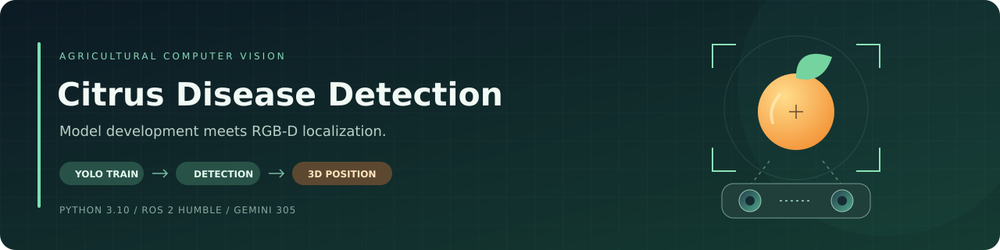
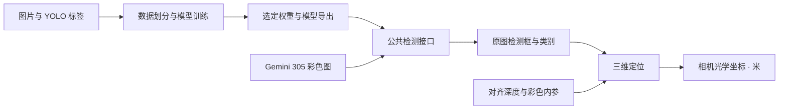

<div align="center">
  

  <h1>柑橘病害检测与 RGB-D 三维定位</h1>

  <p>数据准备 · YOLO 训练 · 相机检测 · 三维坐标</p>

  <p>
    <a href="docs/REPOSITORY_GUIDE.md">仓库结构</a> ·
    <a href="docs/SETUP.md">环境安装</a> ·
    <a href="docs/TRAINING.md">模型训练</a> ·
    <a href="docs/USAGE.md">运行指南</a> ·
    <a href="docs/DEPLOYMENT.md">板端部署</a>
  </p>

  <a href="https://github.com/wyNomad/citrus-disease-detection/actions/workflows/repository-checks.yml"></a>
  
  
</div>

## 项目定位

本项目将**模型开发**与**相机应用**放在同一仓库：上游准备数据、训练和导出模型；下游调用 **Orbbec Gemini 305（G40351-191）** 与选定模型，输出目标类别、像素位置和相机光学坐标系下的三维坐标。

开发环境为 **Ubuntu 22.04 / Python 3.10 / ROS 2 Humble**，目标设备为 **香橙派 5 Plus / RK3588 / Ubuntu 22.04 ARM64**。

| 能力 | 当前状态 |
| --- | --- |
| 数据准备、训练、离线检测、ONNX 导出 | 软件通路已验证 |
| ROS 多目标检测与相机坐标系三维定位 | 合成通路与输入保护已验证 |
| Gemini 305 实际取流、对齐与测距 | 待相机实测 |
| 真实柑橘病害模型效果 | 待真实数据训练与评估 |
| RK3588 ARM64 部署与 NPU 推理 | 待板端适配；RKNN 后端目前为预留接口 |

> 数据集与模型权重需要另行准备。当前完成的是仓库基础与软件校验，硬件和业务效果按上述范围继续验收。

## 从数据到目标坐标



离线工具与 ROS 检测节点共用推理实现，深度采样和反投影集中在公共几何模块。运行时通过配置切换通用物体或病害模型。

## 快速开始

以下命令从仓库根目录执行。使用系统 Python 3.10 创建环境，便于与 ROS Humble 的二进制包配合。

```bash
git clone https://github.com/wyNomad/citrus-disease-detection.git
cd citrus-disease-detection

/usr/bin/python3 -m venv --system-site-packages .venv
source .venv/bin/activate
python -m pip install --upgrade 'pip<26' 'setuptools>=68,<80' wheel
python -m pip install -e . -r requirements/laptop.txt -r requirements/dev.txt
```

**先进行无相机检查：**

```bash
CITRUS_FAIL_ON_SKIP=1 python -m pytest -q --ignore=tests/ros
python examples/offline_localization.py
```

几何示例使用合成深度，预期输出 `[0.1, 0.0, 1.0]` 米。完整 ROS 测试需要先构建并加载项目 overlay，见 [验证指南](docs/VALIDATION.md)。

**准备 `weights/yolov8n.pt` 后，检测一张图片：**

```bash
citrus-detect --config configs/runtime/generic.yaml --source /absolute/path/image.jpg --output runs/detect-001 --save-images
```

结果保存在 `runs/detect-001/`：`detections.jsonl` 包含原图尺寸、类别、置信度、检测框和中心像素；`--save-images` 同时保存标注图片。每次运行请选择新的输出目录，程序拒绝覆盖已有结果，也不会自动下载缺失权重。

## 上游：数据与模型开发

准备训练初始化权重 `weights/yolo11n.pt` 和原始图片/标签，核对配置后执行：

```bash
citrus-prepare-data --source data/raw/testA --output data/citrus_mini --sample 100 --seed 42
citrus-train --config configs/training/citrus.yaml
```

数据划分使用固定 seed，并拒绝已有输出目录。训练为每次任务保存独立数据配置快照，同名训练目录存在时自动递增。

```bash
python -m pip install -r requirements/export.txt
citrus-export --weights runs/train/citrus_experiment/weights/best.pt --format onnx
```

实际训练目录以命令输出为准。选定的业务模型放到 `weights/citrus/best.pt`，或者调整运行配置的模型位置。15 类标签顺序与权重管理约定见 [数据与模型](docs/DATA_AND_MODELS.md)。

## 下游：Gemini 305 与 ROS 2

先按 [环境安装](docs/SETUP.md) 准备 ROS 系统依赖。首次使用时获取固定版本相机驱动；已有 `ros2_ws/src/vendor/orbbec` 时跳过获取步骤。

```bash
source /opt/ros/humble/setup.bash
source .venv/bin/activate
python scripts/setup_camera.py
python scripts/build_ros.py
source ros2_ws/install/setup.bash
ros2 launch citrus_bringup pipeline.launch.py profile:=generic weights_dir:="$PWD/weights"
```

| 配置 | 模型位置，相对 `weights_dir` | 目的 |
| --- | --- | --- |
| `profile:=generic` | `yolov8n.pt` | 用日常物体检查坐标通路 |
| `profile:=citrus` | `citrus/best.pt` | 使用选定的柑橘病害模型 |

`profile_file`、`camera_file` 支持自定义运行和相机配置。`start_camera:=false` 用于外部数据源或 rosbag 输入，节点将等待图像、对齐深度和内参。

### 输出接口

| 话题 | 内容 |
| --- | --- |
| `/citrus/detections` | 图像采集 Header、原图尺寸和本帧全部检测 |
| `/citrus/targets_3d` | 目标检测、深度有效状态及三维位置 |
| `/citrus/annotated_image` | 可选标注图，默认关闭 |

坐标单位为**米**，方向为 **x 向右、y 向下、z 向前**。检测、深度和内参必须使用匹配的彩色光学坐标系；无效深度的目标以 `depth_valid=false` 和 NaN 位置表示。

输出代表中心邻域的可见表面位置。手眼标定、机械臂坐标转换与抓取控制属于后续范围，接口细节见 [架构与消息约定](docs/ARCHITECTURE.md)。

## 仓库导航

| 位置 | 职责 |
| --- | --- |
| [`src/citrus_vision`](src/citrus_vision) | 共用检测接口、配置、数据处理与几何计算 |
| [`scripts`](scripts) | 数据、训练、检测、导出、构建及验证入口 |
| [`configs`](configs) | 数据集、训练、运行模式和相机参数 |
| [`ros2_ws/src`](ros2_ws/src) | 五个自有 ROS 包，以及本地准备的相机依赖 |
| [`dependencies`](dependencies) | 驱动固定提交、补丁与来源 |
| [`requirements`](requirements) | 核心、训练、导出、开发和板端依赖约定 |
| [`tests`](tests) / [`examples`](examples) | 回归测试、合成示例与历史演示 |
| [`weights`](weights) / [`data`](data) | 本地模型与数据的存放约定 |
| [`docs`](docs) | 安装、架构、部署、迁移与验证资料 |

数据、权重、SDK 检出目录、虚拟环境、运行输出和构建产物留在本地，不进入 Git。Python 发行包为 `citrus-vision-core`，导入模块和 ROS 包名为 `citrus_vision`，分别管理包元数据并共用源码。

## 验证与协作

最近的软件验收：**49 项测试零跳过、8 个 ROS 包本地构建通过**，并完成干净环境 wheel 安装、实际 CPU 训练、模型重载、ONNX 导出及数值一致性检查。

GitHub Actions 分为 `core`、`ros`、`training-export` 三个任务，必需测试禁止跳过后报告成功。版本组合、测试边界和硬件待办见 [验证结果](docs/VALIDATION_RESULTS.md)。

| 阅读目的 | 文档 |
| --- | --- |
| 了解完整目录、数据流和修改位置 | [仓库结构与开发导航](docs/REPOSITORY_GUIDE.md) |
| 安装环境与相机驱动 | [环境安装](docs/SETUP.md) |
| 准备数据、管理模型、开展训练 | [数据与模型](docs/DATA_AND_MODELS.md) · [训练流程](docs/TRAINING.md) |
| 启动节点与切换运行配置 | [运行指南](docs/USAGE.md) |
| 理解消息、时间戳和坐标约定 | [架构与接口](docs/ARCHITECTURE.md) |
| 规划香橙派与 RKNN 适配 | [部署边界](docs/DEPLOYMENT.md) |
| 修改后选择校验范围 | [验证指南](docs/VALIDATION.md) · [协作约定](CONTRIBUTING.md) |
| 追溯整合来源 | [迁移记录](docs/MIGRATION.md) · [实验记录](docs/EXPERIMENTS.md) |
